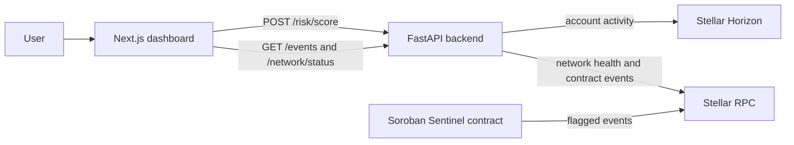

# Stellar Sentinel Frontend

[Open the live dashboard](https://sentinel-frontend-gules.vercel.app)

Stellar Sentinel is a dashboard for screening Stellar account activity and reviewing Soroban contract flag events. Scores are transparent off-chain signals; they do not submit a transaction or create a contract flag.

## Architecture



The browser uses the backend as its only application API. It renders account metrics and signal explanations, the current network/RPC status, and a paginated contract event feed. If loading an older event page fails, already-loaded events remain visible and the failed cursor can be retried. The dashboard keeps up to five successful account assessments in the current page session so analysts can revisit recent results without storing them across reloads. The event feed requires a deployed contract ID configured in the backend.

## Stellar Testnet deployment

The backend is configured for the Stellar Sentinel contract at [`CBVFEUGUZ3P7A3F6B3SZKFJRTSANHYZDGEOFRCRLQL3FG6QCDO7MBJD7`](https://stellar.expert/explorer/testnet/contract/CBVFEUGUZ3P7A3F6B3SZKFJRTSANHYZDGEOFRCRLQL3FG6QCDO7MBJD7). The dashboard reads its Soroban events through `GET /events`. The contract is initialized at threshold 70 with an authorized monitoring agent; the feed populates as the agent's background scan finds accounts that cross the threshold. Deployment and transaction details are in the [contract README](https://github.com/Stellar-Sentinel/sentinel-contracts#testnet-deployment).

## Project layout

- `app/page.tsx` — dashboard, account screening form, event feed, and section navigation.
- `app/globals.css` — responsive layout, sidebar/mobile navigation, and component styles.
- `app/layout.tsx` — document metadata and root layout.
- `.env.example` — frontend API URL for local development.

## Run locally

Requires Node.js 24 (the version used by CI) and npm. Start the backend separately; see [sentinel-backend](https://github.com/Stellar-Sentinel/sentinel-backend).

```bash
cp .env.example .env.local
npm ci
npm run dev
```

Open [http://localhost:3000](http://localhost:3000). `npm run start` serves a production build after `npm run build`.

## Commands

| Command | Purpose |
| --- | --- |
| `npm run dev` | Run the local Next.js development server. |
| `npm run lint` | Run ESLint across the frontend. |
| `npm run build` | Create a production build and check compilation/types. |
| `npm run start` | Serve the production build. |

There is no separate frontend unit-test suite configured yet. CI runs lint and build on pushes to `main` and pull requests.

## Configuration

Set `NEXT_PUBLIC_API_BASE_URL` in `.env.local` (default: `http://localhost:8000`). This value is exposed to the browser, so it must contain only a public API origin, never a secret. The backend's `CORS_ORIGINS` must include the frontend origin, normally `http://localhost:3000`.

## API integration

- `POST /risk/score` returns the account score, signals, metrics, data source, and observation time.
- `GET /events?limit=20&cursor=...` returns paginated contract events.
- `GET /network/status` reports the Stellar network, Soroban RPC health, and latest ledger.

When the backend identifies the network as Public Network or Testnet, account, contract, and available transaction references link to the matching Stellar Expert explorer. Unknown networks and missing transaction hashes remain plain text.

Keep response changes coordinated with the backend. Errors, loading, and empty states should remain explicit; do not replace missing chain data with sample values.

If a new account screening request fails after a successful assessment, the dashboard keeps the last successful result visible and shows the new request error above it.
